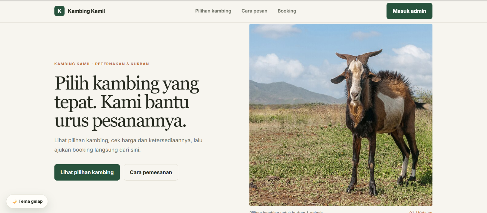
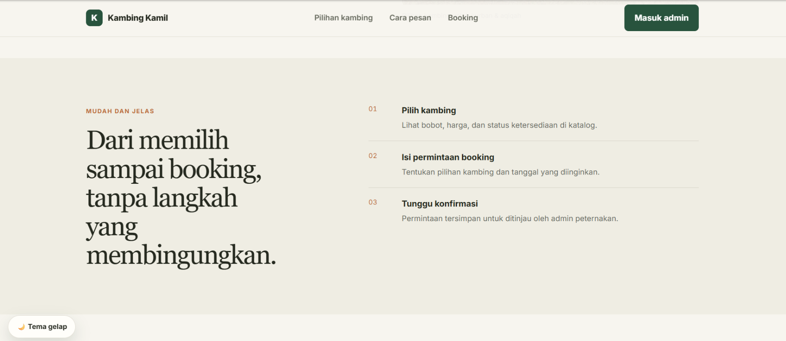
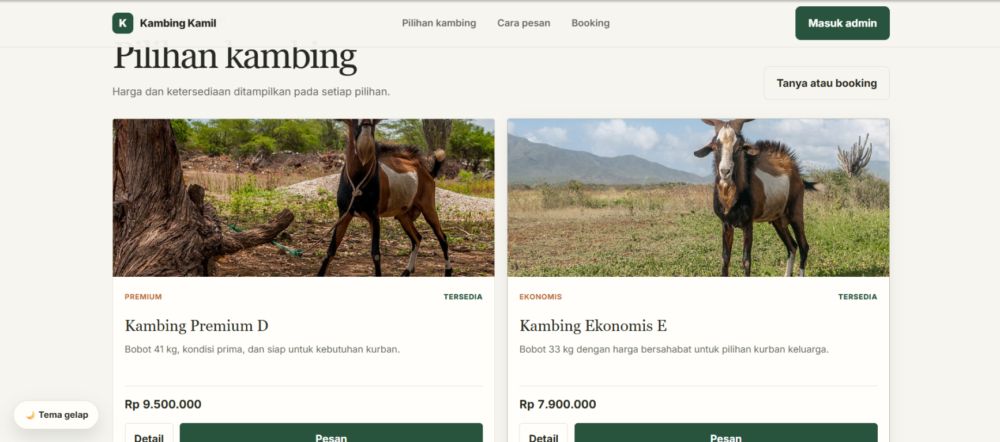
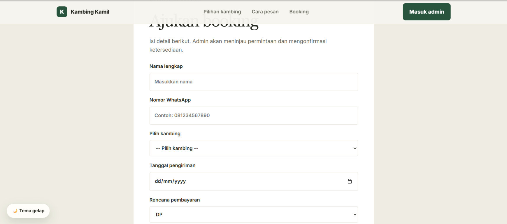
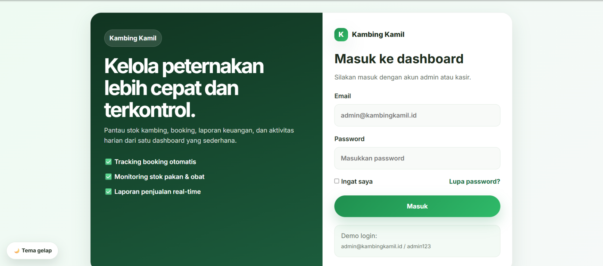
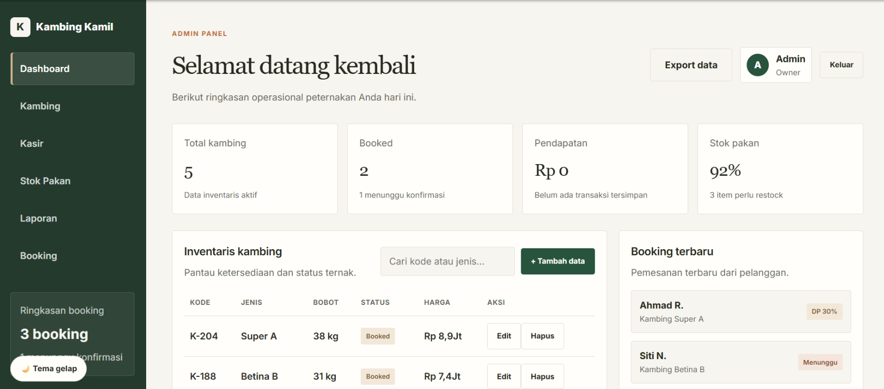
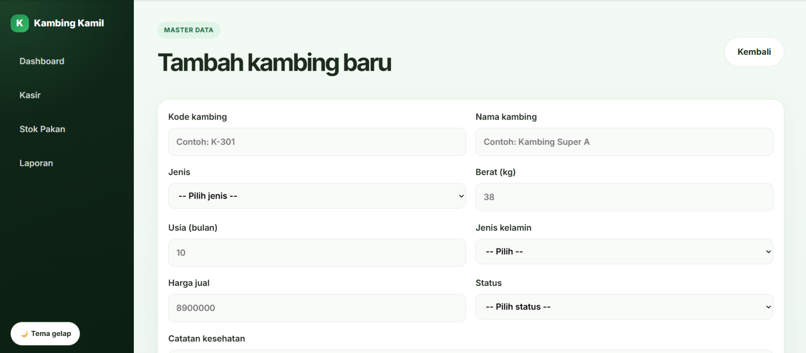
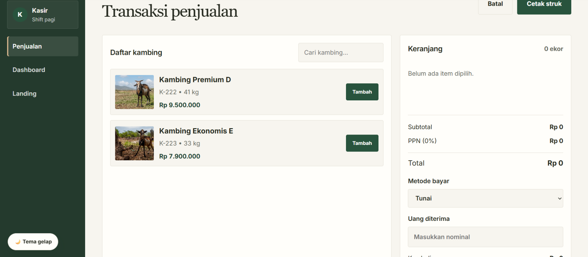
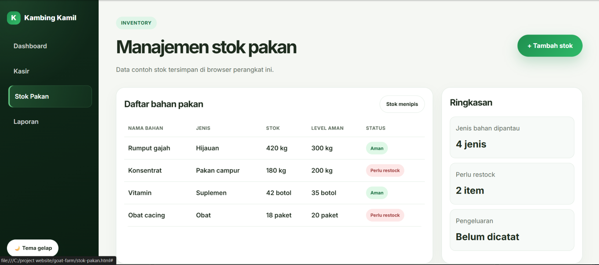
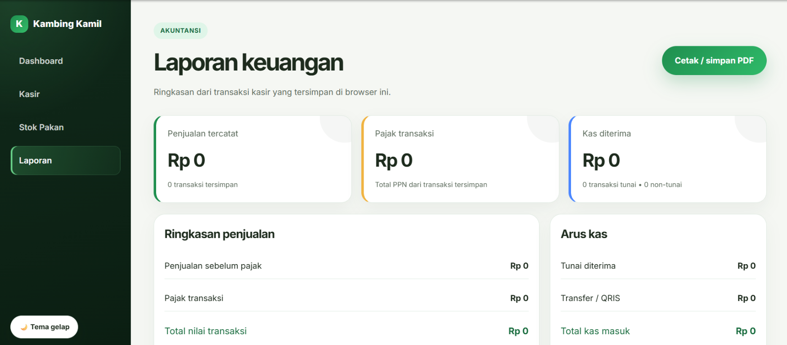

# Kambing Kamil

Proyek UTS Pemrograman Website: prototipe website peternakan kambing untuk menampilkan katalog dan mencatat proses booking serta operasional sederhana.

**Repository GitHub:** [LevMoriarty20/project-website](https://github.com/LevMoriarty20/project-website)

## Fitur

- Katalog kambing, detail produk, dan formulir booking.
- Dashboard inventaris dengan pencarian, tambah, edit, hapus, dan ekspor data kambing.
- Halaman kasir dengan keranjang, metode pembayaran, validasi pembayaran tunai, dan cetak struk.
- Pencatatan stok pakan, konfirmasi DP, serta ringkasan laporan penjualan.
- Tema terang/gelap dan tata letak responsif.

Nama kambing pada data yang sudah dibuat tidak dapat diubah melalui form edit agar tetap konsisten dengan katalog. Penghapusan diblokir jika kambing memiliki riwayat booking atau transaksi.

## Cara menjalankan

1. Clone atau unduh repository ini.
2. Buka folder `goat-farm` di VS Code.
3. Jalankan `index.html` dengan ekstensi Live Server, atau buka file tersebut di browser.
4. Untuk melihat dashboard admin, buka `login.html` dan gunakan akun demo berikut:
   - Email: `admin@kambingkamil.id`
   - Password: `admin123`

Proyek ini berupa frontend statis dan tidak memerlukan instalasi dependency atau server backend.

## Penyimpanan dan batasan demo

Data contoh dan perubahan disimpan di `localStorage` browser. Data hanya tersedia di browser/perangkat yang sama dan dapat hilang jika penyimpanan browser dihapus. Belum ada database, sinkronisasi antarperangkat, ataupun autentikasi server; akun demo tidak boleh digunakan untuk melindungi data nyata.

## Struktur

```text
goat-farm/
├── index.html
├── detail.html
├── login.html
├── admin.html
├── tambah-kambing.html
├── booking-detail.html
├── kasir.html
├── stok-pakan.html
├── laporan.html
├── styles.css
└── script.js
```

## Screenshot aplikasi

Screenshot berikut diambil dari tampilan aktual aplikasi.

### Halaman utama



### Alur pemesanan dan katalog

**Cara pesan**



**Katalog kambing**



**Form booking**



### Halaman admin dan operasional

**Login admin**



**Dashboard admin**



**Form kambing**



**Kasir**



**Stok pakan**



**Laporan keuangan**



## Deployment

Tautan deployment belum tersedia. Tambahkan URL di bagian ini setelah aplikasi dipublikasikan.

## Catatan pengembangan

Agar progres pengerjaan terlihat, buat commit terpisah untuk perubahan yang bermakna (misalnya fitur, perbaikan bug, dan dokumentasi), bukan satu commit besar di akhir.
